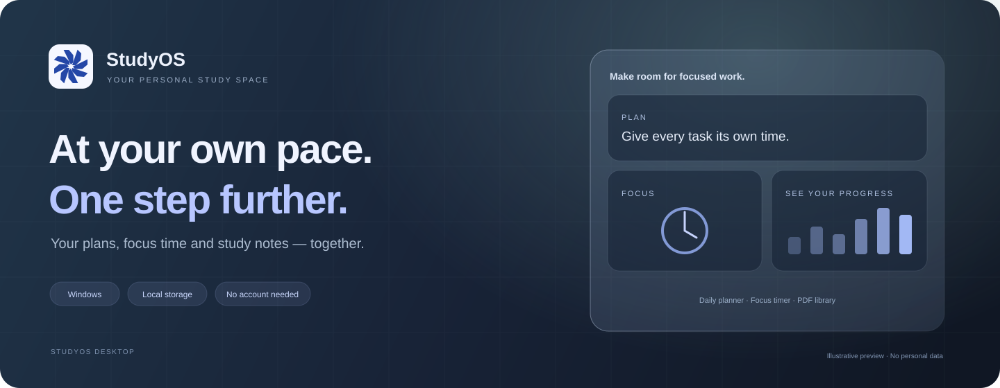

[**English**](README.md) · [Türkçe](README.tr.md)

# StudyOS Desktop

**Your plans, focus time and study notes — together.**

A personal Windows study workspace that keeps your records on your computer. No account required.

[**Download for Windows**](https://github.com/ahmeterdi21/SutudyOS/releases/latest) · [Getting started](docs/INSTALLATION.md) · [Changelog](CHANGELOG.md) · [Feedback](https://github.com/ahmeterdi21/SutudyOS/issues/new/choose)

> **Language:** The application interface is currently in **Turkish**. This repository provides English and Turkish documentation; an English app interface is not included in the current release.

## Build your own study routine

StudyOS is being developed for students, exam preparation and anyone building a consistent learning habit. Add your subjects, organize your day into study blocks, complete focus sessions and see your progress.

Core features work offline. Subjects, tasks and imported PDFs are kept in local storage dedicated to the application. An internet connection is used to check for and download updates.

The banner above is an illustration, not an application screenshot. It contains no personal records. StudyOS is in early development and grows through small updates.

## What you can do

| Area | Features |
|---|---|
| **Dashboard** | See your daily goal, completed focus time and study activity over the last seven days. |
| **Study Room** | Use preset or custom focus durations; pause the timer and keep its state across pages and restarts. |
| **Subjects** | Create subjects or learning areas with a name and color. |
| **Planner** | Add topics, notes, dates, start times and durations; review the day's schedule and overlapping tasks. |
| **PDF Library** | Copy and view your notes inside the app. Up to 25 MB per file. |
| **Statistics** | Review completed focus sessions and your study history. |
| **Appearance** | Choose light or dark mode, adjustable glass surfaces and animated bottom navigation. |

Press and hold to remove a task, subject or PDF. A short click opens a standard confirmation dialog. Removing a subject preserves its linked tasks, files and history.

## Download and get started

1. Open the [latest release](https://github.com/ahmeterdi21/SutudyOS/releases/latest).
2. Under **Assets**, download the StudyOS installer ending in `x64-setup.exe`.
3. Install the app, then create your first subject and task.

**You do not need development tools or a GitHub account to use StudyOS.** The `Source code`, `.sig` and `latest.json` files are not needed for a normal installation.

[Windows installation and first steps](docs/INSTALLATION.md).

## Your records stay on your computer

- Desktop records and PDF copies are stored in a local SQLite database.
- Core features do not require an account or cloud synchronization.
- Importing a PDF copies it into the app; the original file is not modified.
- Back up the complete data folder while the app is closed. JSON exports do not include PDFs.

See the [usage guide](docs/INSTALLATION.md#backups) for storage, backup and timer details.

## Updates

StudyOS checks for a new release at startup. When one is available, you can start installation from the app. Updates are distributed through GitHub Releases and their signatures are verified. You can continue using the installed version while offline.

[Recent changes](CHANGELOG.md) · [All releases](https://github.com/ahmeterdi21/SutudyOS/releases)

## What's next?

The next design iteration targets a modern Windows title bar, a window layout that fits the screen and consistent application icons across Windows.

[Roadmap](docs/ROADMAP.md) · [Suggest a feature](https://github.com/ahmeterdi21/SutudyOS/issues/new?template=feature.yml)

## Get involved

Bug reports, real-world feedback and documentation improvements are all useful contributions.

- [Report a bug or share an idea](https://github.com/ahmeterdi21/SutudyOS/issues/new/choose)
- [Contribution guide](CONTRIBUTING.md)
- [Run from source and test](docs/DEVELOPMENT.md)
- [Documentation languages](docs/LANGUAGES.md)

**Built with:** Tauri 2 · React · TypeScript · Tailwind CSS · Rust · SQLite

## Licensing and credits

UI component sources and credits are listed in [THIRD-PARTY-NOTICES.md](THIRD-PARTY-NOTICES.md). A project-wide license has not yet been selected.

---

Small steps. Lasting habits. <strong>StudyOS.</strong>

