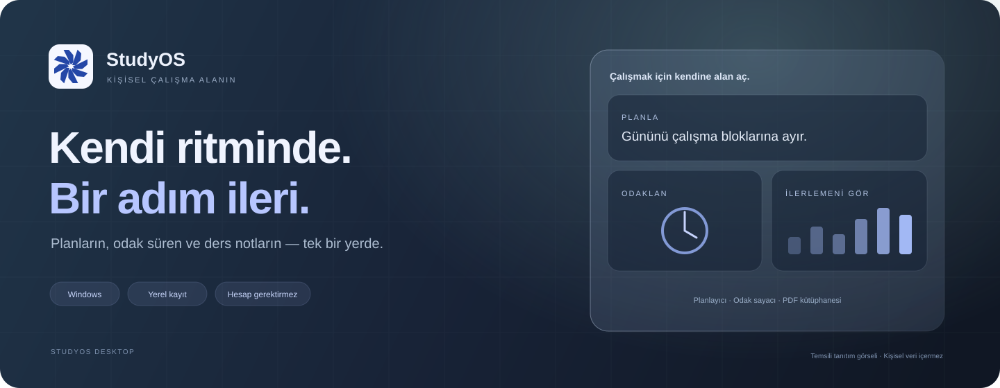

[English](README.md) · **Türkçe**

# StudyOS Desktop

**Planların, odak süren ve ders notların — tek bir yerde.**

Windows için hesabını oluşturmadan kullanabileceğin, verilerini bilgisayarında saklayan kişisel çalışma alanı.

[**Windows için indir**](https://github.com/ahmeterdi21/SutudyOS/releases/latest) · [Kurulum ve kullanım](docs/INSTALLATION.tr.md) · [Sürüm geçmişi](CHANGELOG.tr.md) · [Geri bildirim](https://github.com/ahmeterdi21/SutudyOS/issues/new/choose)

A local-first Windows study workspace with a focus timer, daily planner and personal PDF library. The current interface is in Turkish.

## Kendi çalışma düzenini oluştur

StudyOS; öğrenciler, sınava hazırlananlar ve kendine bir çalışma alışkanlığı kurmak isteyenler için geliştiriliyor. Derslerini ekle, gününü çalışma bloklarına ayır, odak oturumlarını tamamla ve ilerlemeni gör.

Temel özellikler çevrimdışı çalışır. Derslerin, görevlerin ve içe aktardığın PDF'ler uygulamaya özel yerel depolamada tutulur. Güncelleme kontrolü için internet bağlantısı kullanılır.

> Üstteki görsel, kişisel veri içermeyen temsili bir tanıtımdır. Güncel sürüm erken geliştirme aşamasındadır; yeni özellikler küçük güncellemelerle eklenir.

## Neler yapabilirsin?

| Alan | Yapabileceklerin |
|---|---|
| **Ana Panel** | Günlük hedefini, tamamlanan odak süreni ve son yedi günlük çalışma ritmini gör. |
| **Çalışma Odası** | Hazır veya özel sürelerle odaklan; sayacı duraklat, sayfa değiştir ve kaldığın durumu koru. |
| **Derslerim** | Kendi derslerini veya çalışma alanlarını ad ve renkle düzenle. |
| **Planlayıcı** | Görevlerine konu, açıklama, tarih, saat ve süre ekle; günün akışını ve saat çakışmalarını incele. |
| **PDF Kütüphanesi** | Notlarını uygulamaya kopyala ve görüntüle. Dosya başına en fazla 25 MB. |
| **İstatistikler** | Tamamladığın odak oturumlarını ve çalışma geçmişini takip et. |
| **Görünüm** | Açık/koyu tema, ayarlanabilir cam yüzeyler ve animasyonlu alt navigasyon kullan. |

Görev, ders ve PDF'leri basılı tutarak kaldırabilirsin; kısa tıklama normal onay penceresi açar. Bir dersi kaldırmak ona bağlı görevlerini, dosyalarını ve geçmişini silmez.

## İndir ve başla

1. [En güncel sürümü aç](https://github.com/ahmeterdi21/SutudyOS/releases/latest).
2. **Assets** bölümünden `x64-setup.exe` ile biten StudyOS kurulum dosyasını indir.
3. Kurulumu tamamla; ilk dersini ve görevini ekle.

**Uygulamayı kullanmak için yazılım geliştirme araçları veya GitHub hesabı gerekmez.** `Source code`, `.sig` ve `latest.json` dosyaları normal kurulum için gerekli değildir.

Ayrıntılar: [Windows kurulumu ve ilk kullanım](docs/INSTALLATION.tr.md).

## Verilerin sende

- Masaüstü kayıtları ve PDF kopyaları bilgisayarındaki SQLite veritabanında saklanır.
- Uygulamanın temel özellikleri hesap veya çevrimiçi senkronizasyon gerektirmez.
- PDF içe aktarma dosyanı uygulamaya kopyalar; özgün dosyanı değiştirmez.
- Tam yedek için uygulama kapalıyken veri klasörünü kopyalayabilirsin. JSON dışa aktarımı PDF'leri içermez.

Veri konumu, yedekleme ve sayaç davranışı: [kullanım rehberi](docs/INSTALLATION.tr.md#yedekleme).

## Güncellemeler

StudyOS açılışta yeni sürümü kontrol eder. Yeni sürüm varsa uygulama içindeki **Güncelle** düğmesiyle kurulumu başlatabilirsin. Güncellemeler GitHub Releases üzerinden dağıtılır ve imzaları doğrulanır. Bağlantı olmadığında mevcut sürümle çalışmaya devam edebilirsin.

[Son değişiklikler](CHANGELOG.tr.md) · [Tüm sürümler](https://github.com/ahmeterdi21/SutudyOS/releases)

## Sırada ne var?

Bir sonraki tasarım turunda modern Windows üst çubuğu, ekrana oturan pencere düzeni ve sistem genelinde tutarlı uygulama simgeleri hedefleniyor.

[Yol haritasını incele](docs/ROADMAP.tr.md) · [Bir özellik öner](https://github.com/ahmeterdi21/SutudyOS/issues/new?template=feature.yml)

## Geliştirmeye katıl

Bir hata bildirmek, kullanım deneyimini paylaşmak veya belgeyi iyileştirmek de katkıdır.

- [Hata bildir veya fikir paylaş](https://github.com/ahmeterdi21/SutudyOS/issues/new/choose)
- [Katkı rehberi](CONTRIBUTING.tr.md)
- [Kaynaktan çalıştırma ve testler](docs/DEVELOPMENT.tr.md)

**Teknolojiler:** Tauri 2 · React · TypeScript · Tailwind CSS · Rust · SQLite

## Lisans ve atıflar

Kullanılan arayüz bileşenlerinin kaynak ve atıf bilgileri [THIRD-PARTY-NOTICES.md](THIRD-PARTY-NOTICES.md) dosyasındadır. Uygulamanın tamamı için genel bir lisans henüz belirlenmemiştir.

---

Küçük adımlar, kalıcı alışkanlıklar. <strong>StudyOS.</strong>

